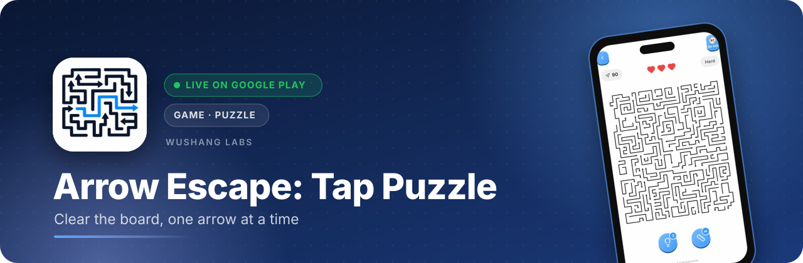
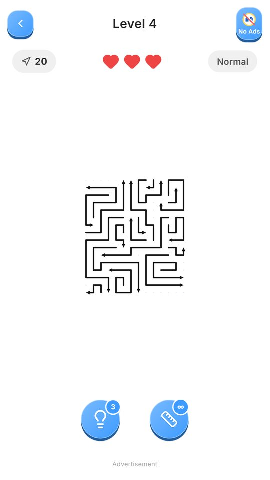
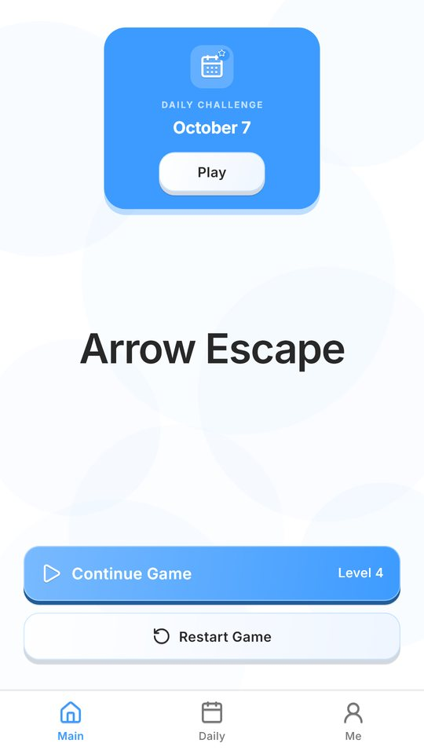
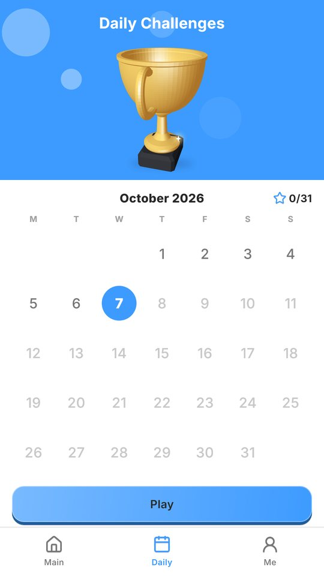
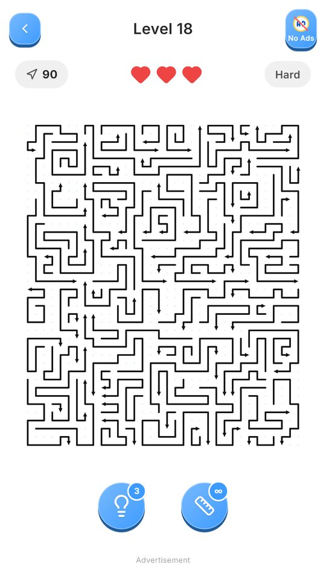

   

---

## ✨ Overview

Arrow Escape is a direction-based logic puzzle: tap an arrow with a clear path and it slides off the board, opening routes for the others. Clear every arrow to win. Levels are **procedurally generated and verified by a solver**, so every board is guaranteed solvable. Rated **⭐ 5.0** on Google Play.

## 🚀 Features

<table>
<tr>
<td width="50%" valign="top"><h3>🧩 50 campaign levels</h3>Easy → Very Hard difficulty presets</td>
<td width="50%" valign="top"><h3>📅 Daily challenges</h3>A fresh puzzle every day</td>
</tr>
<tr>
<td width="50%" valign="top"><h3>💡 Hints</h3>Spot an arrow that can escape</td>
<td width="50%" valign="top"><h3>✨ Animated escapes</h3>Arrows follow their bends head-to-tail; collisions cost a life</td>
</tr>
<tr>
<td width="50%" valign="top"><h3>🔍 Pinch zoom</h3>For dense, hard boards</td>
<td width="50%" valign="top"><h3>💾 Saved progress & stats</h3>No login required</td>
</tr>
<tr>
<td width="50%" valign="top"><h3>🚫 No-Ads purchase</h3>One-time IAP removes banners and between-level ads</td>
<td width="50%" valign="top"><h3>🎁 Optional rewarded ads</h3>Earn boosts without forced ads</td>
</tr>
</table>

## 📱 Screenshots

  
  
  
   
  

## 🧱 Tech stack

  
  
  
  
  
  
  

## 🏗️ Architecture

## 🔍 Engineering highlights

- **Procedural level generator**: each level number maps to deterministic seeds and an original silhouette (hearts, spirals, butterflies, mazes…)
- Independent **occupancy + ray-cast solver** rejects deadlocked, sparse or unbalanced boards before they reach players
- Per-difficulty targets for arrow count and silhouette coverage (e.g. Very Hard: 32–44 arrows, 82% occupancy)
- Custom painter with a single aspect-preserving transform; arrows animate along rounded maze paths
- Automated tests check every campaign level's clearing order and path continuity
- Monetisation with AdMob (banner/interstitial/rewarded) + RevenueCat No-Ads IAP

## 🔒 About this repository

This is a **product showcase**. The source code, credentials and signing keys are private. Happy to walk through the architecture and code in an interview — reach out below.

---

  Designed & built by <a href="https://github.com/theajay17"><b>Ajay Kumar Saw</b></a> · AJAY LABs  
  
  
  

